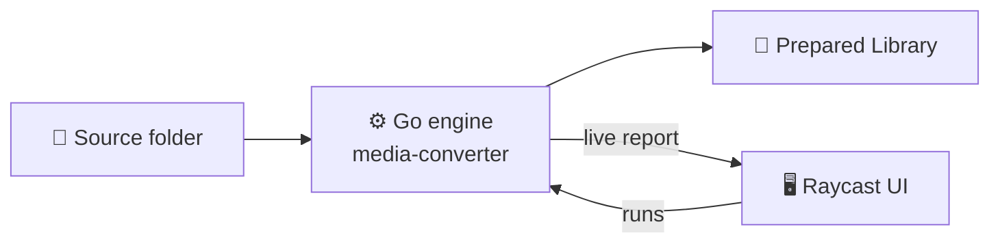

<div align="center">

# 🎬 Dailies

**Prepare your camera footage safely, in one click.**


</div>

## ✨ What it does

- 🎥 **Prepare** video and photos into a clean **Prepared Library**
- 🛡️ **Copy-safe**: your originals are never touched
- 👀 **Dry-run first**: see what will happen before anything is written
- 📊 **Live reports**: follow each run, then read the Backup Report

## 🧭 How it works



The Raycast UI only orchestrates. All the work happens in the Go engine.

## 🚀 Quick start

**1. Install the tools** (once):

```bash
brew install go node ffmpeg imagemagick
```

**2. Launch the Raycast extension:**

```bash
make raycast-binaries   # build the engine for Raycast
make raycast-install    # install extension dependencies
make raycast-dev        # start it in Raycast dev mode
```

## ⌨️ Command line

```bash
./media-converter --dry-run SOURCE DEST    # preview only, writes nothing
./media-converter SOURCE DEST              # prepare the library
./media-converter --copy-only SOURCE DEST  # archive copy, no conversion
```

## 🧑‍💻 For developers

<details>
<summary>Repo layout, tests and naming conventions</summary>

- `main.go`, `cmd/`, `internal/`: Go engine
- `apps/raycast/`: Raycast extension (UI only)
- `scripts/build-raycast-binaries.sh`: builds the macOS binaries
- `Makefile`: all dev commands

Run the tests with `make test`.

Dev only: fall back to a `media-converter` on your PATH:

```bash
export CAMERA_WORKFLOW_ALLOW_PATH_FALLBACK=1
```

Extension docs: [`apps/raycast/README.md`](apps/raycast/README.md)

**Naming:** say *Prepare* (not convert) · *Prepared Library* (not output folder) · *Backup Report* (not run summary) · *Backup Preparation Run* (not generic run).

**Releases:** published from this repo. The legacy Camera-Workflow repos are archived and redirect here.

</details>
